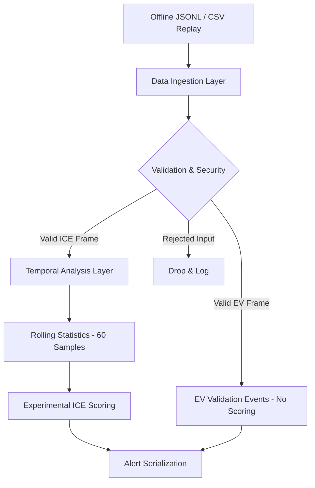

AutoPulse separates offline ingestion and schema validation from in-memory ICE
analysis and event serialization. The current implementation uses fixed
heuristics and rolling statistics. Learned healthy-baseline training and
persistence and calibrated vehicle-failure prediction are not implemented.

## System Diagram

## Core Layers

### Data Ingestion and Validation

The [US-001 Data Contract](../../specs/us-001-engine-data-contract/) defines ICE
input-policy ranges and hashed identifiers. [US-006](../../specs/us-006-ev-telemetry-data-contract/)
uses a separate EV schema and routing path. Accepted ranges and protocol labels
do not establish automotive compliance or physical safety.

EV support covers validation, routing, adapter guardrails, replay, and event
serialization. It includes no EV anomaly scoring or live EV capture.

The [Stationary Smoke Test](../../guides/stationary-smoke-test/) describes a
separate bounded ICE harness with operator prerequisites. It is repository-only:
`autopulse.live` is excluded from wheel and sdist distributions. Passing offline
tests or reading that guide does not authorize a vehicle connection.

### Temporal Analysis

The processor retains 60 accepted samples per monitored channel by default.
Sampling cadence determines the duration represented by those statistics; the
buffers are not time-evicted. Three-point median and EWMA filters smooth detector
inputs, while raw samples supply Z-score and IQR checks. Filters can delay
transitions and do not train a healthy-vehicle baseline.

Timestamp order is strict. A gap greater than 60 seconds starts a new session;
first frames seed state with zero HDF/OSF contribution. Explicit reset clears
session state. See the [processor time contract](https://github.com/ajason13/autopulse/blob/main/docs/specs/processor-time-contract.md).

### Experimental ICE Scores

The [analysis reference](../anomaly-detection/) describes:

- HDF's observed arming sequence and temperature/RPM equation for eligible inputs.
- OSF's low-RPM/high-load exposure fraction over a separate 60-second horizon.
- Rolling statistical outlier and sensor-error branches.

The legacy `failure_probability` field carries an experimental score. Branch
labels do not confirm vehicle faults, and scores do not establish failure
likelihood or maintenance recommendations. See [evidence and limitations](../empirical-validation/).

## Current Development and Review Rules

Applicable global and [repository AGENTS.md instructions](https://github.com/ajason13/autopulse/blob/main/AGENTS.md)
govern current work. One Codex session owns one focused behavior change per PR;
GitHub Issues track criteria, verification, and delivery. Risk-sensitive changes
require a fresh-context Codex review supplied with acceptance criteria, the final
diff, and verification evidence; material findings must be resolved before handoff.

External-model and Notion workflows are used only when explicitly requested.
Historical multi-model audit records preserve provenance and past verdicts;
they do not impose current mandatory review gates or certify product safety.
